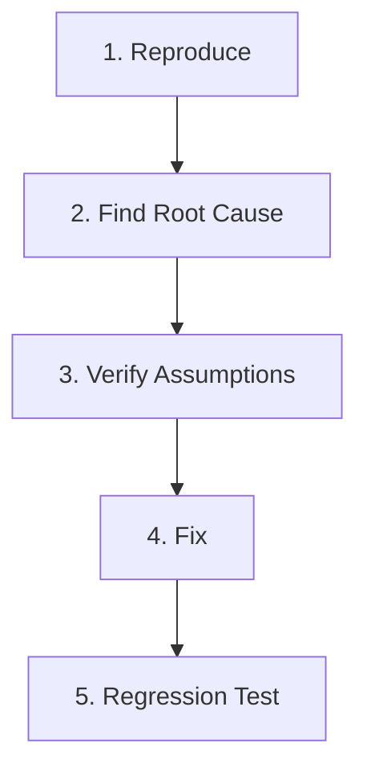

# Bug Fix Workflow

This workflow defines the mandatory process for diagnosing, isolating, fixing, and verifying bugs in `jump-delay-fix`.

---

## Stage 1: Reproduce
- **Collect Failure Context:**
  - Minecraft version, mod loader (Fabric vs NeoForge), loader version.
  - Multiplayer environment: singleplayer vs dedicated server, anticheat presence (GrimAC, Vulcan, etc.), ping / latency.
- **Formulate Minimal Reproduction:**
  - Create a deterministic automated test case in `common/src/test/java` or an explicit series of player actions that reliably reproduce the defect.
  - Never proceed to fix code before reproducing the bug or writing a failing test.

---

## Stage 2: Find Root Cause
- **Trace Execution Path:**
  - Inspect `JumpDelayFix.onClientTick()`, `JumpHandler.tick()`, or `ConfigStorage.load()`.
  - Check state transitions in `RuntimeState` and `ServerAdaptiveStats`.
- **Identify Failure Mode:**
  - Is it a timing race condition?
  - Is it an anti-cheat false-positive where lift was not detected within timeout?
  - Is it an encoding issue in configuration persistence?
  - Is it a discrepancy between Fabric and NeoForge event lifecycles?

---

## Stage 3: Verify Assumptions
- **Question Existing Hypotheses:**
  - Do not assume the existing code was right and the user environment was wrong.
  - Verify assumptions using debugger, log outputs, or test assertions.
  - Verify if the bug affects both Fabric and NeoForge or only one loader.
- **Evaluate Side Effects:**
  - Could fixing this cause rubberbanding on high-latency connections?
  - Could this alter the player's legitimate jumping height or timing?

---

## Stage 4: Fix
- **Targeted Minimal Change:**
  - Apply the cleanest, most maintainable fix directly at the root cause.
  - Avoid defensive workarounds or "band-aid" patches that mask the underlying failure.
- **Maintain Source Hygiene:**
  - **Zero comments:** Do not add `//` or `/* */` comments explaining the bug fix in Java sources.
  - **Zero markers:** Do not leave `// FIXME` or `// BUG FIX` in code.
  - Make the code self-explanatory through clean naming.
- **Multi-Loader Consistency:**
  - If the fix touches loader glue, apply matching changes to both `fabric/` and `neoforge/`.

---

## Stage 5: Regression Test
- **Assert Failure Now Passes:**
  - Run the newly created regression test; verify it now passes.
- **Full Quality Gauntlet:**
  - Run `./gradlew test` to ensure no existing tests broke.
  - Run `./gradlew strictCheck publishReadyCheck` to confirm full pipeline health.
- **Changelog Entry:**
  - Document the bug fix in `CHANGELOG.md` under `### Fixed`.
