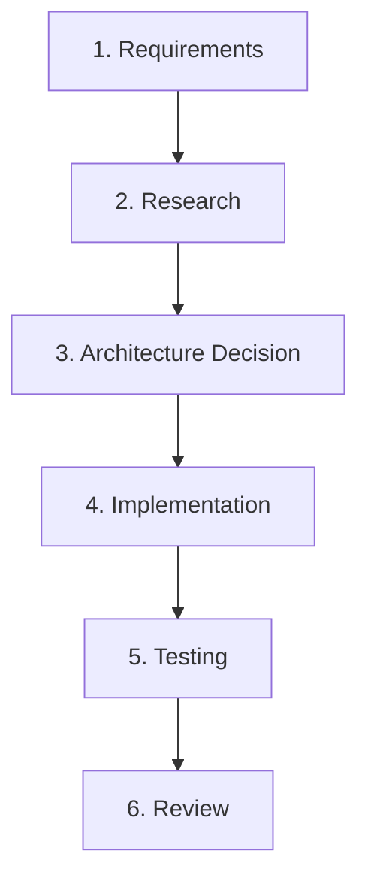

# New Feature Workflow

This workflow defines the mandatory process for designing, implementing, and delivering new capabilities in `jump-delay-fix`.

---

## Stage 1: Requirements
- **Define User Objective:** What problem does this feature solve for the player?
- **Scope & Constraints:**
  - Client-side only. Must not require server-side mod installation.
  - Performance constraint: Must not cause frame drops, GC pressure, or allocations in tick loops.
  - Multi-loader parity: Must work identically on Fabric and NeoForge.
  - Backward compatibility: Must not invalidate existing user settings in `jumpdelayfix.properties`.

---

## Stage 2: Research
- **Inspect Minecraft Source & Loom Mappings:**
  - Check relevant classes in `net.minecraft.client.*` (e.g. `LocalPlayer`, `Options`, `KeyMapping`).
  - Verify whether the desired API is stable across Minecraft patch updates.
- **Inspect Existing Repository Patterns:**
  - Check how similar features are wired in `common`, `fabric`, and `neoforge`.
  - Check whether `JumpInput` or `ToggleFeedback` already provide appropriate hooks.
- **Check External Documentation:**
  - Review Fabric Wiki and NeoForge Documentation for version-specific breaking changes.

---

## Stage 3: Architecture Decision
- **Modular Boundary Placement:**
  - Does this logic belong in `:common`? (Default: YES. All business logic, state machines, and calculations must reside in `:common`).
  - What minimal interfaces are required in `:common` for loader adapters to implement?
- **Configuration & Persistence:**
  - Does this feature need a persistent setting?
  - If yes, define the property in `RuntimeConfig`, `ConfigStorage`, and `ConfigManager`.
- **UI & Localization:**
  - Does it need buttons or options on the settings screen?
  - Plan translation keys and update all 10 language files in `common/src/main/resources/assets/jumpdelayfix/lang/`.
- **Explain Trade-offs:** Document why this architectural approach was selected over alternatives.

---

## Stage 4: Implementation
- **Source Hygiene:**
  - High comment hygiene: meaningful explanatory comments are permitted; avoid redundant comments.
  - Strictly **ZERO** marker tags (`TODO`, `FIXME`, `XXX`).
  - Strictly **ZERO** wildcard imports.
  - Use self-documenting code with expressive method and variable names.
- **Common Module First:**
  - Implement domain logic, state models, and configuration storage in `:common`.
- **Loader Adapters Second:**
  - Implement loader-specific glue in `:fabric` and `:neoforge`.
  - Maintain exact parity between `FabricSettingsScreen` and `NeoForgeSettingsScreen`.
- **Formatting:**
  - Run `./gradlew spotlessApply` to ensure 4-space indentation and clean formatting.

---

## Stage 5: Testing
- **Unit Tests:**
  - Write comprehensive JUnit 5/6 tests in `common/src/test/java/`.
  - Use mock/fake implementations of `JumpInput` to test edge cases.
- **Localization Test:**
  - Run `LocalizationCompletenessTest` to guarantee all 10 locales match `en_us.json`.
- **Server Safety Test:**
  - Run `:neoforge:verifyDedicatedServerSafe` to ensure no client classes leak into dedicated server classpaths.
- **Build Verification:**
  - Run `./gradlew strictCheck publishReadyCheck buildAll`.

---

## Stage 6: Review
- **Self-Audit:**
  - Run `git diff` and verify every changed line against repository standards.
  - Confirm no files were accidentally added to the root `src/` directory.
  - Confirm instruction and branch coverage did not regress in JaCoCo reports.
- **Documentation Update:**
  - Document the feature in `docs/wiki/User-Guide.md` or `docs/wiki/Configuration.md`.
  - Add an entry under the unreleased / candidate version section in `CHANGELOG.md`.
