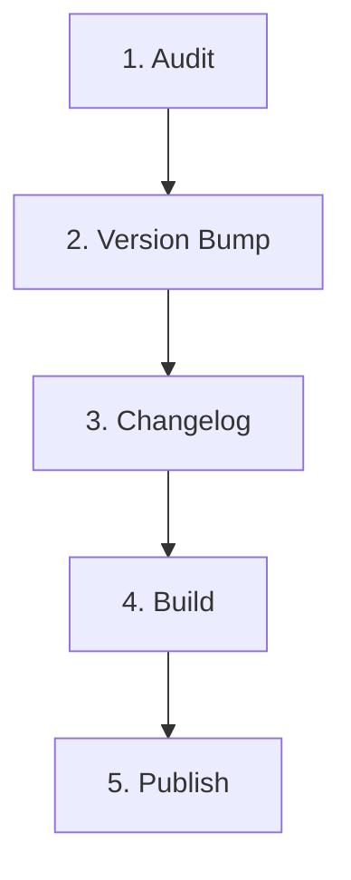

# Release Workflow

This workflow defines the mandatory release procedure for publishing official versions of `jump-delay-fix`.



---

## Stage 1: Audit
- **Check Working Tree Status:**
  - `git status` must be clean. No uncommitted modifications or untracked files.
- **Check Active Branch:**
  - Releases must originate from `main`, `release/*`, or `support/*`.
- **Pre-Release Verification:**
  - Run the release script in dry-run mode:
    ```bash
    ./scripts/release.sh --dry-run
    ```
  - This executes hygiene checks, structure validation, strict compilation, test runs, and test artifact builds.

---

## Stage 2: Version Bump
- **SemVer Compliance:**
  - Increment version according to SemVer rules:
    * `PATCH`: Bug fixes, minor adjustments, compatibility metadata updates.
    * `MINOR`: New features, new profiles, new UI options (backwards compatible).
    * `MAJOR`: Breaking changes to configuration format or core architecture.
- **Execute Version Update:**
  - Run `scripts/set-minecraft-version.sh` to update `gradle.properties`:
    ```bash
    ./scripts/set-minecraft-version.sh \
      --base-minecraft <mc_version> \
      --supported-versions "<mc_versions>" \
      --mod-version <new_semver_version>
    ```
- **Matrix Consistency:**
  - Verify `verifyMinecraftVersionMatrix` and `verifySemverVersion` pass.

---

## Stage 3: Changelog
- **Format:**
  - Ensure `CHANGELOG.md` contains a dedicated heading for the new release:
    ```markdown
    ## <mod_version>

    ### Added
    - ...

    ### Changed
    - ...

    ### Fixed
    - ...
    ```
  - The script `./scripts/release.sh` strictly checks for `## <mod_version>` in `CHANGELOG.md`.

---

## Stage 4: Build
- **Clean Release Compilation:**
  - Run `./gradlew clean buildAll` to produce release JARs for all loaders:
    * `fabric/build/libs/jumpdelayfix-fabric-${minecraft_version}-${mod_version}.jar`
    * `neoforge/build/libs/jumpdelayfix-neoforge-${minecraft_version}-${mod_version}.jar`
- **Verify Artifacts:**
  - Ensure both JAR files exist, are non-empty, and contain compiled classes, assets, and licenses.

---

## Stage 5: Publish
- **Execute Automated One-Command Release:**
  - Run the release script in publish mode:
    ```bash
    ./scripts/release.sh --publish
    ```
  - What this script does automatically:
    1. Validates structure and hygiene.
    2. Runs `strictCheck` and `publishReadyCheck`.
    3. Builds all loader artifacts.
    4. Creates the annotated git tag `v<mod_version>` and release commit.
    5. Pushes the branch and tag to GitHub origin.
- **Automated CI Delivery:**
  - GitHub Actions `.github/workflows/release.yml` will automatically:
    * Build in a pristine environment.
    * Extract release notes from `CHANGELOG.md`.
    * Generate SHA-256 checksums.
    * Publish GitHub Release.
    * Publish to Modrinth for both Fabric and NeoForge.
    * Publish to CurseForge (if token is configured).
